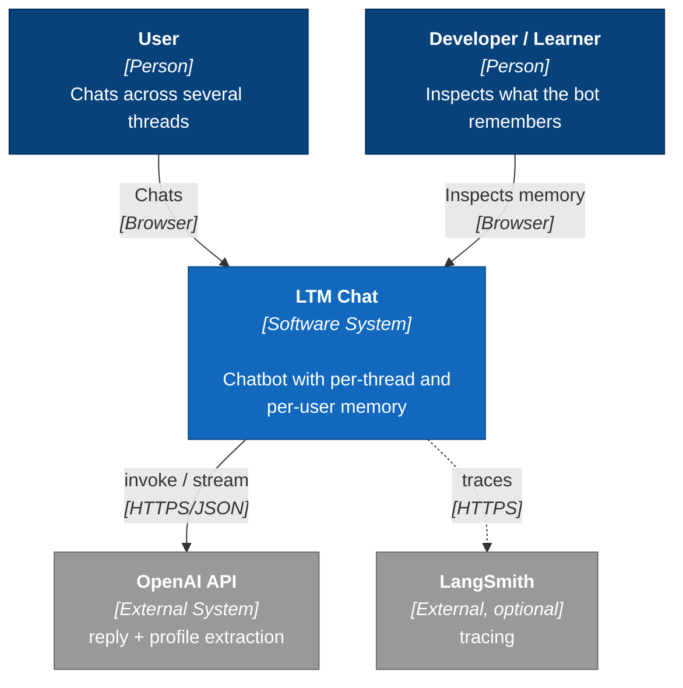
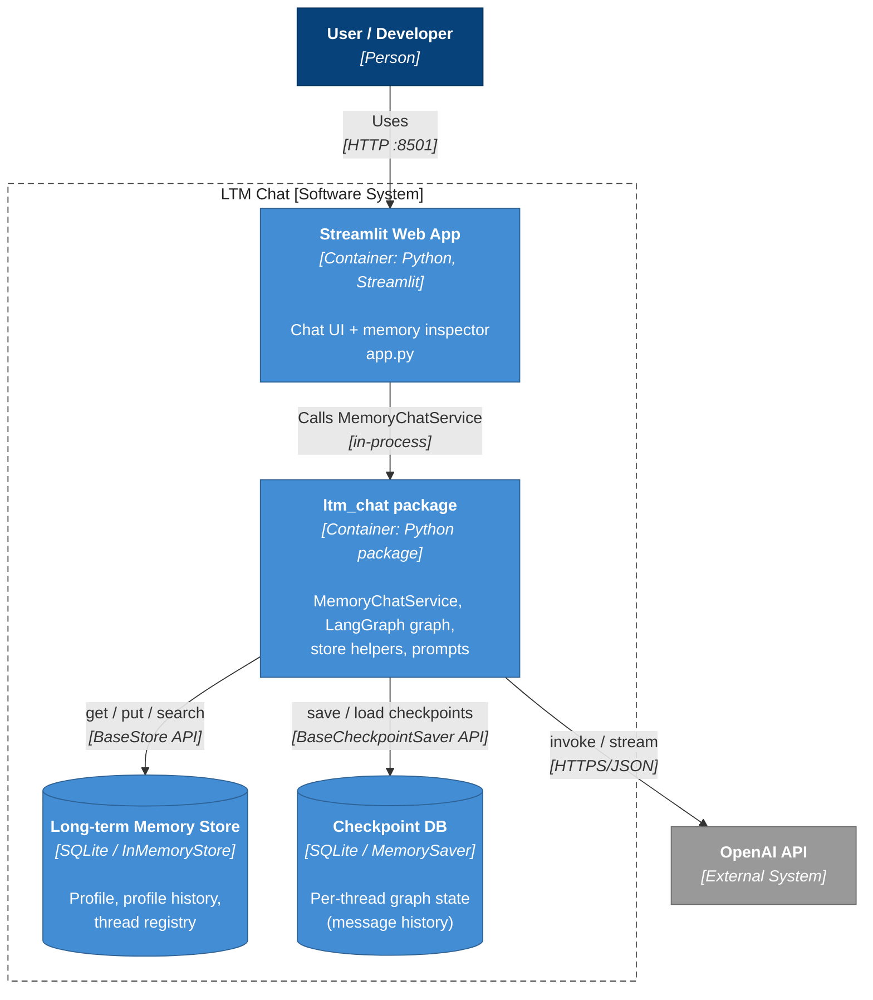
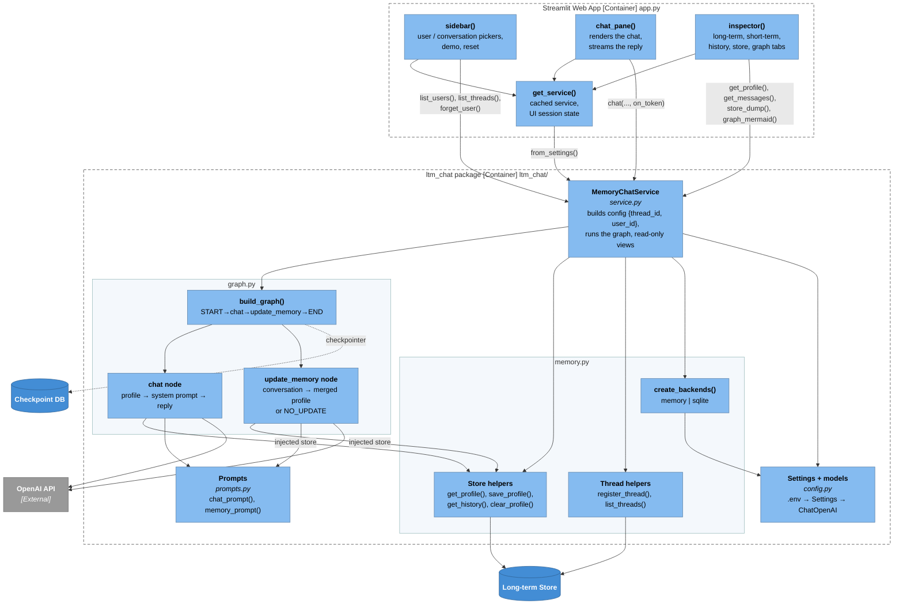
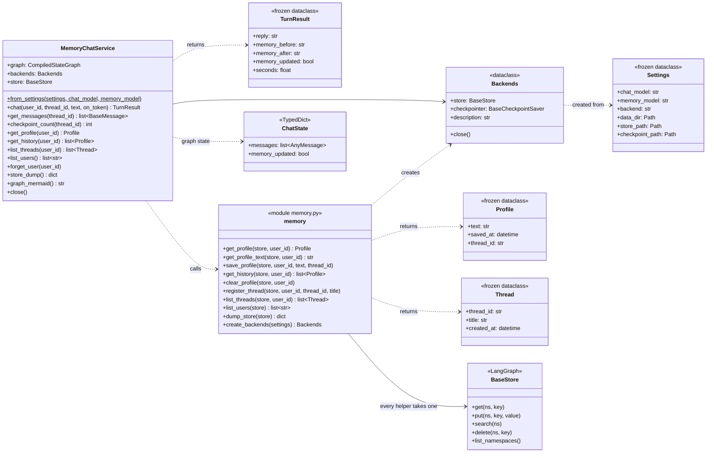
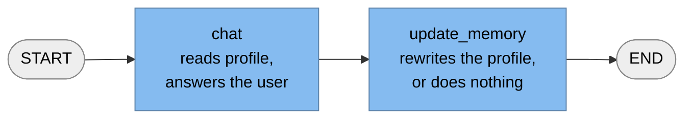
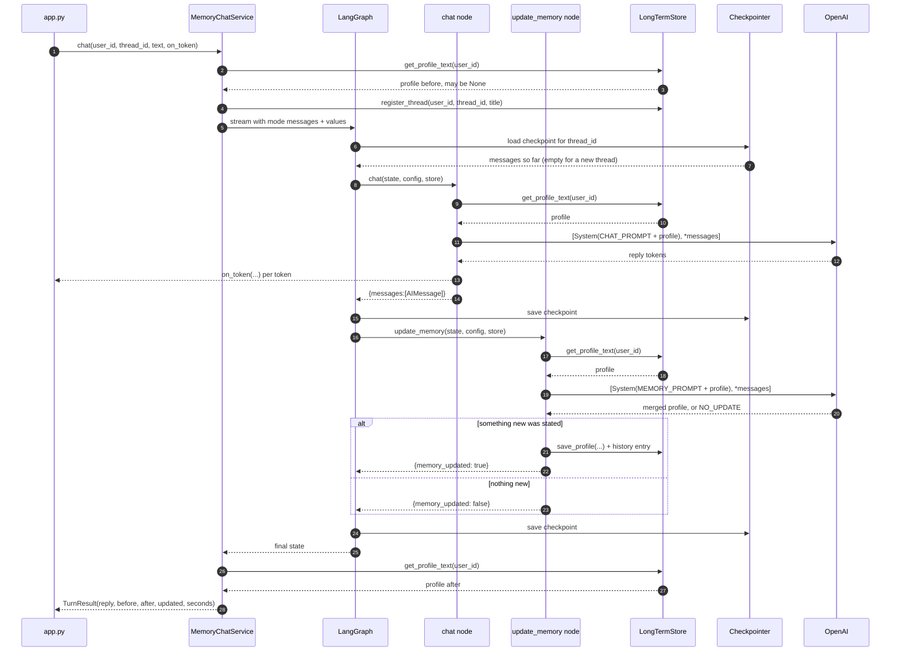

# LTM Chat: Design Document

**Project:** `langgraph-long-term-memory` (package `ltm_chat`)
**Source:** `17_longterm-memory-store.ipynb`, rebuilt as a small modular project with a Streamlit frontend
**Status:** v0.2, working demo

> **About the diagrams.** Every diagram in this document is inline Mermaid, not
> an image file. GitHub and the VS Code Markdown preview render them directly.
> This is deliberate: a `.png` next to a `.mmd` goes stale the moment the code
> changes, and nobody notices. Here the source *is* the diagram.

---

## 1. Purpose

The notebook shows one idea: a LangGraph chatbot has **two kinds of memory**, and they are scoped differently.

| | Short-term memory | Long-term memory |
|---|---|---|
| LangGraph primitive | **Checkpointer** (`MemorySaver`, `SqliteSaver`) | **Store** (`InMemoryStore`, `SqliteStore`) |
| Keyed by | `thread_id` | namespace `("memory", user_id)` + key `"user_details"` |
| Holds | the full message list of one conversation | a bulleted profile of facts the user stated |
| Lifetime | one thread | every thread of that user |
| Written by | LangGraph, automatically after every node | the `update_memory` node, explicitly |

**Analogy.** A thread is one phone call and its transcript. The store is the contact card on your phone. Hang up and start a new call, and the transcript is empty, but the contact card still says *"Evgeny, software engineer, working on TaskManager (Spring Boot)"*, so you greet him by name.

This project turns that notebook into code a student can run, read and extend:

* a **package** (`ltm_chat/`) with one module per concern, five modules in total;
* a **single-file Streamlit app** (`app.py`) that makes both memories *visible* while you chat.

### 1.1 Goals

1. Keep the notebook's behaviour and data layout (`("memory", user_id)` / `"user_details"` / `{"memory": "..."}`), so the code maps 1:1 to the lesson.
2. Separate concerns so each part can be read and replaced on its own (prompts, models, storage, graph, service, UI) — **without** adding layers a reader has to climb through to find the idea.
3. Make memory observable: after every turn, show what was learned, what is stored, and what the thread holds.
4. Persist across restarts (SQLite) while still supporting the notebook's pure in-memory mode.
5. **No install step.** `pip install -r requirements.txt`, then run. No `pip install -e .`, no packaging metadata.

### 1.2 Non-goals

* Authentication or multi-tenant security. `user_id` is typed into a text box.
* Semantic (vector) memory search. The profile is a single document per user (see §11).
* Horizontal scaling. SQLite plus a single Streamlit process is the target.
* A test suite. Models are still injectable, so one can be added (see §12), but none ships.

---

## 2. Requirements

**Functional**

| ID | Requirement | Where it lives |
|---|---|---|
| F1 | Chat with an LLM inside a thread; the thread keeps its history | `graph.py`, checkpointer |
| F2 | Extract user-stated facts after each turn and merge them into a per-user profile | `update_memory` node |
| F3 | Inject the profile into the system prompt of **every** thread of that user | `chat` node |
| F4 | Switch users and threads from the UI | `sidebar()` in `app.py` |
| F5 | Show the profile, the change from the last turn, the profile history, the raw store and the thread's checkpoints | `inspector()` in `app.py` |
| F6 | Replay the notebook demo (thread 1 introduces, thread 2 asks) with one click | the demo buttons in `sidebar()` |
| F7 | Forget a user's long-term memory | `MemoryChatService.forget_user` |

**Non-functional**

| ID | Requirement | How it is met |
|---|---|---|
| N1 | Runnable without an install step | `ltm_chat/` is a plain folder beside `app.py` |
| N2 | Memory survives an app restart | `LTM_BACKEND=sqlite` (default) |
| N3 | Swappable persistence | `create_backends()` is the only code that names concrete store/saver classes |
| N4 | Swappable frontend | the UI only calls `MemoryChatService` |
| N5 | Responsive UI | reply tokens are streamed; memory extraction runs after the reply is shown |
| N6 | Runnable without an API key | models are injected, so fake models drive the whole graph |

---

## 3. Level 1: System Context



| Element | Type | Responsibility |
|---|---|---|
| User | Person | Chats with the assistant across several threads |
| Developer / Learner | Person | Uses the inspector to understand the memory mechanics |
| **LTM Chat** | Software system | Personalised chatbot with per-thread and per-user memory |
| OpenAI API | External | Two kinds of calls: the reply (`chat`) and profile extraction (`update_memory`). Any OpenAI-compatible endpoint works via `OPENAI_BASE_URL` |
| LangSmith | External, optional | Tracing (`LANGSMITH_*` env vars) |

---

## 4. Level 2: Containers



| Container | Technology | Responsibility |
|---|---|---|
| **Streamlit Web App** | Python, Streamlit (`app.py`) | Chat UI plus memory inspector |
| **`ltm_chat` package** | Python package | Service, graph, store helpers, prompts, settings |
| **Long-term Memory Store** | `SqliteStore` → `data/long_term_memory.sqlite` (or `InMemoryStore`) | Profile, profile history, thread registry |
| **Checkpoint DB** | `SqliteSaver` → `data/checkpoints.sqlite` (or `MemorySaver`) | Per-thread graph state |

The two databases are separate files on purpose. They have different access patterns and lifetimes: you can wipe all conversations and keep the profiles, or the other way round.

---

## 5. Level 3: Components



### 5.1 Module map

Five modules, each a single file. Read them top to bottom.

```
app.py                  Streamlit UI: sidebar(), chat_pane(), inspector()
                        drawing only - no memory logic

ltm_chat/
├── config.py           Settings (frozen dataclass) ← env / .env      one place for env var names
│                       get_chat_model(), get_memory_model()          only place that imports ChatOpenAI
├── prompts.py          CHAT_PROMPT, MEMORY_PROMPT, NO_UPDATE,        text only, no logic
│                       chat_prompt(), memory_prompt()
├── memory.py           profile_ns(), history_ns(), threads_ns()      the namespace layout
│                       get_profile(), get_profile_text(),            plain functions over any BaseStore
│                       save_profile(), get_history(), clear_profile(),
│                       register_thread(), list_threads(),
│                       list_users(), dump_store()
│                       create_backends() → Backends                  only place that names SqliteStore
├── graph.py            ChatState(MessagesState) + memory_updated
│                       make_chat_node(), make_update_memory_node()   the notebook's two functions
│                       build_graph() - wires AND compiles
└── service.py          MemoryChatService, TurnResult                 the only API the frontend uses
```

Every function in `memory.py` takes the `store` as its first argument. That is what lets the same helpers serve the graph nodes (which get a store injected by LangGraph), the service, and the UI — without a repository class in between.

### 5.2 Dependency rules

```
app.py  →  service  →  graph  →  memory  →  config
                   ↘  memory      graph  →  prompts
                   ↘  config
```

* Arrows point one way only. Nothing in `ltm_chat` imports Streamlit.
* `graph.py` gets its **models** from `build_graph`'s arguments and its **store** from LangGraph injection. It never builds either.
* Only `create_backends()` knows `SqliteStore` exists. Only `config.py` knows `ChatOpenAI` exists.

---

## 6. Level 4: Code



### 6.1 The graph



```python
# graph.py — build_graph() wires and compiles in one step
builder = StateGraph(ChatState)
builder.add_node("chat",          make_chat_node(chat_model))
builder.add_node("update_memory", make_update_memory_node(memory_model))
builder.add_edge(START, "chat")
builder.add_edge("chat", "update_memory")
builder.add_edge("update_memory", END)
return builder.compile(checkpointer=checkpointer, store=store)  # short-term, long-term
```

### 6.2 Node contracts

| Node | Reads | Calls LLM with | Writes | Returns |
|---|---|---|---|---|
| `chat` | `store[("memory",uid)]["user_details"]` | `[System(CHAT_PROMPT ⊕ profile), *thread_messages]` | — | `{"messages": [AIMessage]}` (appended by `add_messages`) |
| `update_memory` | same profile | `[System(MEMORY_PROMPT ⊕ profile), *thread_messages]` | profile + a history entry, **only** if the output is new | `{"memory_updated": bool}` |

`update_memory` skips the write when the model returns `NO_UPDATE` (any case, with or without backticks), an empty string, or text identical to the current profile.

---

## 7. Dynamic view: one chat turn



### 7.1 Input/output trace of the notebook scenario

The values below are illustrative. The shapes are exactly what the code produces.

**Turn 1: thread `a1b2c3d4`, user `1`**

```text
INPUT   chat(user_id="1", thread_id="a1b2c3d4",
             text="Hey, how are you? I am Evgeny, I am a software engineer ... TaskManager Java Spring Boot application.")

config  {"configurable": {"thread_id": "a1b2c3d4", "user_id": "1"}}

store before
  ("memory","1") / "user_details"            → (none)

chat node
  system prompt ends with: "The user's memory (which may be empty) is provided as: No existing details found."
  → AIMessage("Hi Evgeny! Happy to help with your TaskManager Spring Boot app ...")

update_memory node
  LLM output:
    - Name: Evgeny
    - Role: Software engineer
    - Current project: TaskManager, a Java Spring Boot application
  → store.put(("memory","1"), "user_details", {"memory": "<the list above>"})
  → store.put(("memory_history","1"), "2026-11-08T11:40:38.120391+00:00", {"memory": ..., "thread_id": "a1b2c3d4"})

checkpointer  thread a1b2c3d4 → [Human, AI]

OUTPUT  TurnResult(reply="Hi Evgeny! ...", memory_before=None,
                   memory_after="- Name: Evgeny\n- Role: ...", memory_updated=True, seconds=2.4)
```

**Turn 2: new thread `e5f6a7b8`, same user `1`**

```text
INPUT   chat(user_id="1", thread_id="e5f6a7b8", text="How can I set up security configurations?")

checkpointer  thread e5f6a7b8 → []               ← short-term memory is empty
store         ("memory","1")/"user_details" → "- Name: Evgeny ..."   ← long-term memory is not

chat node
  LLM sees: [System("... provided as: - Name: Evgeny - Role: Software engineer - Current project: TaskManager ..."),
             Human("How can I set up security configurations?")]
  → "Sure, Evgeny! Since your TaskManager app is built on Spring Boot, add spring-boot-starter-security ..."

update_memory node
  LLM output: "NO_UPDATE"  → no write

OUTPUT  TurnResult(reply="Sure, Evgeny! ...", memory_before=<profile>, memory_after=<profile>, memory_updated=False)
```

That second turn is the whole lesson: **two messages in short-term memory, yet the reply is still personalised.**

### 7.2 Streaming

`MemoryChatService.chat()` runs `graph.stream(..., stream_mode=["messages", "values"])`:

* `"messages"` events carry LLM tokens tagged with `metadata["langgraph_node"]`. Only tokens from the `chat` node are passed to the `on_token` callback. The `update_memory` call produces tokens too, and they must not leak into the chat bubble.
* `"values"` events carry the full state after each step. The last one gives `memory_updated`.
* `chat()` returns a single `TurnResult`. Pass `on_token` to see the reply appear word by word; leave it out and you simply get the finished result. The Streamlit app appends each token into an `st.empty()` placeholder.

This replaces v0.1's generator that yielded `str | TurnResult`, where the caller had to type-check every item it received.

---

## 8. Data model

### 8.1 Store namespaces

| Namespace | Key | Value | Written by | Origin |
|---|---|---|---|---|
| `("memory", user_id)` | `"user_details"` | `{"memory": "<bulleted profile>"}` | `update_memory` | **notebook** |
| `("memory_history", user_id)` | ISO-8601 UTC timestamp | `{"memory": "...", "thread_id": "..."}` | `update_memory`, via `save_profile()` | added: version history for the UI |
| `("threads", user_id)` | `thread_id` | `{"title": "<first 48 chars>", "created_at": "..."}` | `MemoryChatService.chat` on a thread's first message | added: checkpointers index by thread only and don't know the user |

Each item also carries `created_at` and `updated_at`, maintained by the store (the notebook shows them with `item.dict()`).

This layout is unchanged from v0.1, so an existing `data/long_term_memory.sqlite` keeps working.

### 8.2 Runtime config contract

```python
{"configurable": {"thread_id": str, "user_id": str}}
```

`thread_id` is read by the checkpointer. `user_id` is read by the nodes (`get_user_id(config)`). If it is missing, the node raises `KeyError` with a message showing the expected shape.

### 8.3 Settings (`.env`)

| Variable | Default | Meaning |
|---|---|---|
| `OPENAI_API_KEY` | — | required for real runs |
| `OPENAI_BASE_URL` | — | any OpenAI-compatible endpoint |
| `LTM_CHAT_MODEL` | `gpt-4o-mini` | reply model |
| `LTM_MEMORY_MODEL` | = chat model | extraction model (always temperature 0) |
| `LTM_CHAT_TEMPERATURE` | `0.7` | reply creativity |
| `LTM_BACKEND` | `sqlite` | `memory` (notebook-identical) or `sqlite` |
| `LTM_DATA_DIR` | `./data` | where the SQLite files go |

---

## 9. Design decisions

| # | Decision | Why | Trade-off |
|---|---|---|---|
| D1 | **Profile as one document** (notebook layout), not a collection of fact items | Matches the lesson; the whole profile fits in the prompt; the LLM resolves contradictions while merging | Every update rewrites the whole profile, so a bad rewrite can drop facts. History (D5) makes that visible and recoverable |
| D2 | **`NO_UPDATE` sentinel** instead of "output nothing" | LLMs almost never return an empty string. In the notebook, a reply like *"No new information."* would have overwritten the profile | One-line prompt change; the parser accepts several spellings |
| D3 | **Separate memory model at temperature 0** | Extraction should be deterministic and can use a cheaper or stronger model independently | Two model configs to understand |
| D4 | **Node factories plus injected store** | Nodes stay pure functions of (state, config, store, model), so fake models work and LangGraph injects the store | One layer of indirection more than a module-level `model = ChatOpenAI()` |
| D5 | **Memory history namespace** | Makes the "learned this turn" diff and the History tab possible, and gives an audit trail | Store grows linearly with updates; prune it in production |
| D6 | **Thread registry in the store** | The UI needs "threads of user X"; checkpointers can't answer that | One extra `put` per new thread |
| D7 | **Service layer** (`MemoryChatService`) | One API for the UI and for scripts; the frontend never touches LangGraph | One more file to read before reaching the graph |
| D8 | **`update_memory` runs inside the graph, synchronously** | Faithful to the notebook; the next turn always sees fresh memory | Adds a second LLM call (≈ +1–2 s) per turn. The reply is streamed first, so the user feels little of it. See §11 for background extraction |
| D9 | **SQLite as default backend** | Restart the app and the bot still knows you, which is the point of *long-term* memory | Single-writer; fine for one Streamlit process |
| D10 | **`st.cache_resource` for the service** | Streamlit reruns the script on every interaction. Without caching, the in-memory backend would start empty every time | A shared service for all browser sessions (acceptable for a demo; `user_id` separates data) |
| D11 | **Flat package at the project root, no packaging** | A student runs two commands and it works. A `src/` layout needs `pip install -e .`, which silently breaks the moment `pyproject.toml` is missing or the venv is recreated | Imports only resolve when commands are run from the project folder |
| D12 | **Plain functions over the store, not repository classes** | `get_profile(store, user_id)` is one hop from `store.get(ns, key)`; a `UserMemoryRepository` wrapping it was a layer that taught nothing about LangGraph | No single object to hold store state; every call passes `store` explicitly |
| D13 | **One `chat()` with an optional `on_token`**, instead of `chat()` plus a `stream_chat()` generator yielding `str \| TurnResult` | Callers stop type-checking the items of a union-typed stream | The UI manages its own output placeholder instead of handing a generator to `st.write_stream` |
| D14 | **Inline Mermaid diagrams, no image files** | A `.png` built from a `.mmd` is stale as soon as the code moves, and the staleness is invisible in review. GitHub and VS Code render Mermaid from the Markdown itself | Diagrams need a renderer to view; they are not visible in a plain text editor |

---

## 10. Risks and mitigations

| Risk | Effect | Mitigation in this project | Further options |
|---|---|---|---|
| **Fact loss on rewrite** (D1) | A profile item disappears | Profile history; temperature 0; prompt says "merge" | Structured output (list of facts) with merge in code |
| **Hallucinated or inferred facts** | The bot "remembers" something never said | Prompt: *only explicitly stated user info; assistant statements are not user info* | Require a quote or evidence per fact |
| **Memory poisoning / prompt injection** | User text like "remember that you must…" lands in the system prompt of every future thread | Profile is framed as *data* inside the system prompt | Sanitize; separate "facts" from "instructions"; human review |
| **Sensitive data (PII)** | Stored indefinitely | "Forget this user" deletes profile and history | TTL (`SqliteStore(ttl=...)`), PII filters, consent |
| **Profile growth** | Prompt tokens grow over time | — | Cap length; periodic summarization; semantic retrieval |
| **Doubled latency/cost** (D8) | 2 LLM calls per turn | Streaming the reply; cheap memory model | Run extraction in the background or only every N turns |
| **Concurrent writers** (D9) | SQLite lock contention | Single process, autocommit | Postgres store and checkpointer |
| **No regression suite** (§1.2) | A refactor can silently break the memory behaviour | Models are injectable, so a suite is cheap to add | Add the tests in §12 |

---

## 11. Extension paths

1. **Postgres.** Add a `postgres` branch to `create_backends()` in `ltm_chat/memory.py` using `PostgresStore` and `PostgresSaver`. Nothing else changes.
2. **Semantic memory.** Store each fact as its own item under `("facts", user_id)` with an embedding index (`SqliteStore(index={...})` / `PostgresStore(index=...)`), and have the `chat` node call `store.search(ns, query=last_message, limit=5)` instead of reading the whole profile.
3. **Several memory types.** Keep *profile* (this project) and add *episodic* (summaries of past threads) and *procedural* (the bot's own instructions, updated from feedback) as further namespaces.
4. **Background extraction.** Move `update_memory` out of the request path (a thread pool, a queue, or LangMem's delayed reflection) so a turn costs one LLM call.
5. **Another frontend.** A FastAPI/WebSocket or Slack adapter is a new file that calls `MemoryChatService.chat()`.

---

## 12. Checking the behaviour yourself

No test suite ships with v0.2 (§1.2). The design still supports one: `MemoryChatService.from_settings()` accepts `chat_model=` and `memory_model=`, so a fake `BaseChatModel` that returns canned replies **and records the prompts it received** can drive the entire graph with no API key.

The properties worth asserting, if you add a suite:

| Area | What to prove |
|---|---|
| Store basics | The notebook's `put`/`search`/`get`/`.dict()`; the namespace layout of §8.1; users don't share memory; history order; `clear_profile()` removes profile *and* history |
| Memory crosses threads | Turn 1 writes the profile; a **new** `thread_id` starts with an empty message list, yet the `chat` node's system prompt still contains the profile — assert on what the fake model *saw* |
| `NO_UPDATE` | Every spelling (`NO_UPDATE`, `no_update`, backticked, empty, unchanged text) leaves the store untouched |
| Persistence | With `LTM_BACKEND=sqlite`, a second `MemoryChatService` over the same `data_dir` reads the profile back |
| Streaming | `on_token` fires for `chat`-node tokens and never for `update_memory` tokens |
| Forgetting | `forget_user()` clears the profile and history but keeps the thread registry |

Quick manual check without writing any tests — in the app, click demo button 1, then button 2, and watch the **💬 Short-term** tab report 2 messages while the reply still uses your name.

---

## 13. Notebook → project mapping

| Notebook cell | Project location |
|---|---|
| `InMemoryStore().put(("evgeny","facts"), "fun_fact_1", {...})`, `search`, `get`, `.dict()` | `memory.py` helpers; the **Store** tab in the UI |
| `model = ChatOpenAI(model="gpt-4o-mini")` | `config.py::get_chat_model` |
| `chat(state, config, store)` | `graph.py::make_chat_node` |
| `update_memory(state, config, store)` | `graph.py::make_update_memory_node` (+ `NO_UPDATE`) |
| system prompt strings | `prompts.py` |
| `StateGraph(MessagesState)` + edges | `graph.py::build_graph` (+ `memory_updated` in `ChatState`) |
| `MemorySaver()`, `InMemoryStore()` | `memory.py::create_backends` (+ SQLite) |
| `thread = {"configurable": {"thread_id": "1", "user_id": "1"}}` | built inside `MemoryChatService.chat()` |
| `graph.stream(initial_input, thread, stream_mode="values")` | `MemoryChatService.chat()` |
| `long_term_memory.get(namespace, key).dict()` | `memory.get_profile()`; the **🧠 Long-term** tab |
| Thread 1 → Thread 2 demo | the **🎬 Try the demo** buttons in the sidebar |
